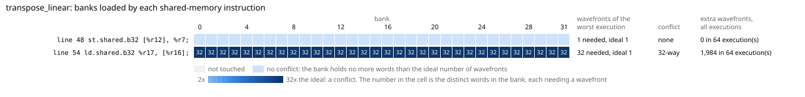
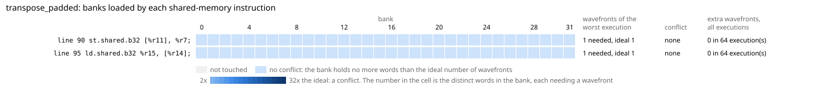
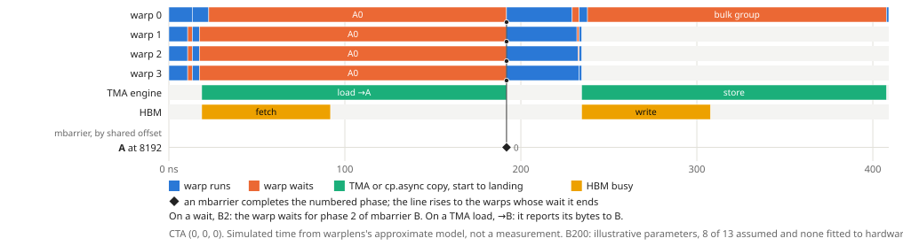
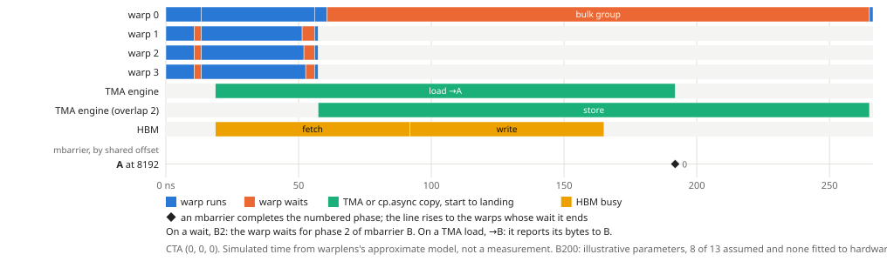
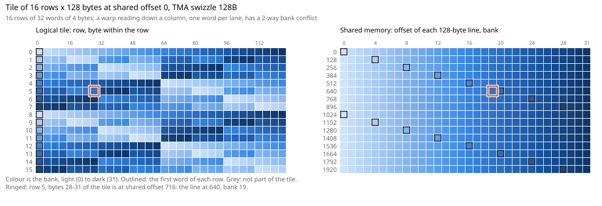
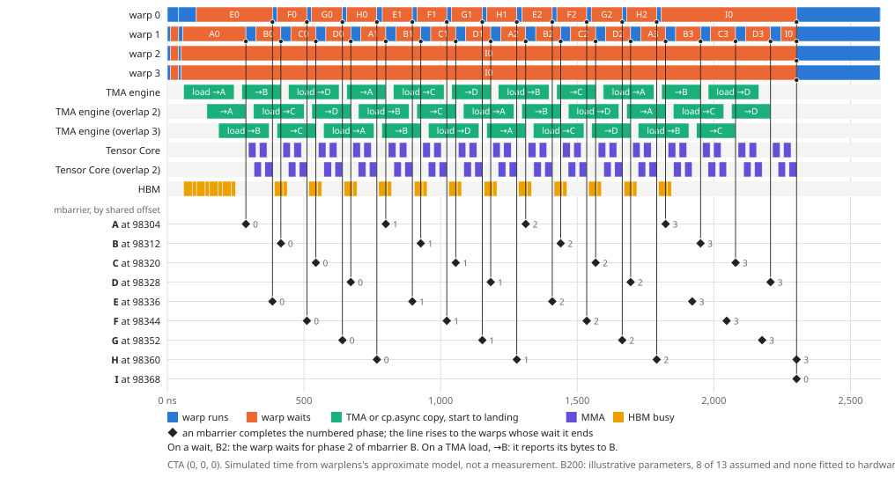

# Gallery: three pictures and how to read them

Each example asks one question of a kernel in `examples/` and answers it with
the pictures warplens draws. Every picture here is the unedited output of a
function of `warplens.viz`; `python tools/make_gallery.py` writes them all, and
`tests/documentation/test_gallery.py` fails if they are stale. `warplens report program`
(guide, section 6.8) puts the same views of your own kernel on one page.

The files are SVG with a tooltip on every mark. A Markdown viewer shows them
as images, without the tooltips; open the file itself in a browser to hover.

Two kinds of statement appear below, and they are not the same kind:

- **What the kernel does**: which words an instruction touches, which bank
  they are in, what a warp waits for, what a checker found. This is computed
  by executing the PTX. The bank-conflict counts have been compared with a
  GPU's counters and agree (`docs/b200-rental-1.md`, Timing).
- **When it happens**: every number in nanoseconds. This comes from the
  approximate timing model. Each timeline says under it which parameters it
  used. Here they are the illustrative defaults, most of them assumed, so the
  order of events and what waits for what are worth reading, and the durations
  are not evidence about hardware. Section 3 says how to use the parameters
  fitted to a B200 instead, which are labelled as an experimental fit and are
  still a simulation.

## 1. Where is the bank conflict, and what does padding change?

`examples/01_smem_transpose` transposes a 32 x 32 tile of floats through
shared memory: each warp stores one row, `tile[y][x]`, then loads one column,
`tile[x][y]`.

```python
from warplens.viz import smem
stats = sim.launch("examples/01_smem_transpose/transpose.ptx", "transpose_linear", ...)
svg = smem.bank_heatmap_svg(stats.smem)
```



How to read it:

- **A row is one instruction** of the PTX, with its line number. Here line 48
  is the store of a row and line 54 the load of a column.
- **A column is one of the 32 banks.** A wavefront serves each bank once, so
  an execution needs as many wavefronts as its fullest bank holds distinct
  words.
- **Colour is conflict, not load.** The lightest shade means the bank held no
  more words than the ideal for that access; a darker cell holds more, and
  the number in it is how many. The store's row is light throughout: 32 lanes,
  32 banks, one wavefront. The load's row is the darkest shade with 32 in
  every cell.
- **The three columns on the right give the verdict in numbers.** The load's
  worst execution needed 32 wavefronts where 1 is ideal, a 32-way conflict,
  and over its 64 executions it cost 1,984 extra wavefronts.

Why 32 in *every* bank, when one warp's column sits in one bank? A cell is the
worst single execution, and each warp reads a different column: warp 7 puts 32
words in bank 7, warp 12 in bank 12. So the picture locates the conflict in
the instruction (line 54), and the next one locates it in memory.

```
python -m warplens.viz.smem 32 128 --mark 5 7 --svg linear.svg
```

![Layout of tile[32][32]](gallery/transpose_linear.layout.svg)

- **Left, the tile as the program indexes it**: a row per row, a cell per
  4-byte word, coloured by the bank the word is in. Every column is one shade
  from top to bottom: all 32 words of a column are in the same bank. That is
  the conflict.
- **Right, shared memory itself**: one 128-byte line per row of the picture,
  one word per bank. The tile's rows are exactly the lines.
- **The ringed cell is one element followed across**: `tile[5][7]` (row 5,
  bytes 28-31) is at shared offset 5 x 128 + 28 = 668, in the line at 640,
  bank 7. So is word 7 of every other row.

The padded kernel declares `tile[32][33]`, which puts the rows 132 bytes apart:

```
python -m warplens.viz.smem 32 128 --pitch 132 --mark 5 7 --svg padded.svg
```

![Layout of tile[32][33]](gallery/transpose_padded.layout.svg)

Each row now starts one bank later than the one above (the outlined first
words step down the diagonal on the right), so a column on the left runs
through all 32 shades. `tile[5][7]` has moved to offset 5 x 132 + 28 = 688,
bank 12, and its column neighbours are in banks 11 and 13. The grey diagonal
is the padding word of each row: the cost of the fix is 32 words of shared
memory. The heatmap of the padded kernel confirms it from the run:



Both rows light, "none", 0 extra wavefronts.

## 2. The copy returns wrong data: what did the warp not wait for?

`examples/02_tma_copy` loads a 16 x 32 tile of floats into shared memory with
TMA, doubles it, and stores it back. With `bug = 3` the kernel leaves out the
wait on the load's mbarrier, and the output is wrong. First the correct run:

```python
stats = sim.launch("examples/02_tma_copy/tma_copy.ptx", "tma_copy", ..., timing=True)
svg = warplens.viz.timeline_svg(stats.timing)
```



How to read a timeline:

- **A row per warp**, blue while it runs and orange while it waits. The text
  on a wait says what for: `A0` is phase 0 of mbarrier A, `bulk group` is a
  `cp.async.bulk.wait_group`, `barrier` a `bar.sync`.
- **A row per engine.** A green bar on the TMA engine is one copy from the
  time the engine takes it up until it has landed. `load →A` means the load reports its
  bytes to mbarrier A. The yellow bar under it is the part of that time this
  SM's share of HBM was busy fetching the bytes.
- **A row per mbarrier**, lettered by shared offset. A diamond is one phase
  completing, with the phase number beside it. The line that rises from it
  ends, with a dot, on each warp whose wait it ended.

So in the correct run: warp 0 issues the load and all four warps wait for
`A0`. The load lands, phase 0 of A completes, and the line from that diamond
releases all four at once. They compute, warp 0 issues the store and waits for
its bulk group until the store has landed.



The same kernel without the wait. Three things are different, and each can be
seen without hovering:

1. **No warp has an `A0` bar.** The short orange bars are `bar.sync`, and the
   long one on warp 0 is the store's `bulk group`.
2. **The warps' blue bars run under the green load.** They read and write the
   tile while the load is still in flight, and warp 0 issues the store (the
   second green bar) before the load has landed.
3. **The diamond of A has no line.** The phase completes and nobody was
   waiting for it.

The checkers say the same with the PTX lines
(`gallery/tma_copy_no_wait.findings.txt`):

```text
[tma-load-unsynchronized] read of shared memory that the TMA load at line 73 writes; that load is still in flight (96 times)
  line 99: ld.shared.b32 %r18, [%r17];
  first in CTA (0, 0, 0), warp 1, lanes 0-31
[smem-uninitialized-read] read of shared memory that this CTA never wrote (96 times)
  line 99: ld.shared.b32 %r18, [%r17];
  first in CTA (0, 0, 0), warp 1, lanes 0-31
[tma-load-unsynchronized] write to shared memory that the TMA load at line 73 writes; that load is still in flight (96 times)
  line 101: st.shared.b32 [%r17], %r19;
  first in CTA (0, 0, 0), warp 1, lanes 0-31
```

The findings do not depend on the timing model: they come from what each warp
had synchronized with, and the same three are reported with timing off. The
timeline adds the picture of why.

Where a warp must look for an element of that tile is a separate question,
because the tensor map uses the 128-byte swizzle:



Row 5, bytes 28-31 of the tile (ringed) is not at 5 x 128 + 28 = 668 but at
shared offset 716, bank 19: within each 128-byte line TMA has moved the
16-byte chunks, differently in each row. The rows on the left are still the
lines on the right; only the order within a line changes, which is why the
colours on the left come in blocks of four words.

## 3. In a multistage pipeline, what is each warp waiting for?

`examples/04_pipelined_gemm` with 4 stages. Warp 0 is the producer: it issues
the two TMA loads of a stage (a tile of A and one of B). Warp 1 is the
consumer: it issues four MMAs per stage and a commit. The kernel has nine
mbarriers, declared in this order: `full[0..3]`, `empty[0..3]`, `done`.



The barrier rows are in the order of their shared offsets, so A to D are
`full[0..3]`, E to H are `empty[0..3]`, and I is `done`. The picture shows
which is which without the source:

- **The loads name their barrier.** The first two green bars are `→A`, the
  next two `→B`: two loads fill a stage, and both report to that stage's
  `full` barrier. A's diamond comes when the second of them lands.
- **Warp 1 waits on A, B, C, D in turn** (`A0`, `B0`, `C0`, `D0`, then `A1`):
  the consumer waits for a stage to be full. Each of those waits ends on the
  line from that barrier's diamond. The purple MMAs follow each one.
- **Warp 0 waits on E, F, G, H** (`E0`, `F0`, ...): the producer waits for a
  stage to be empty before it loads into it again. `E0` completes shortly
  after `A0`, when the MMAs that read stage 0 are done, and the next `→A`
  load starts there.
- **Warps 2 and 3 wait for `I0` from the start**, and warps 0 and 1 join them
  at the end: `done`, the commit of the last MMAs. Its diamond releases all
  four into the epilogue.

To find what a warp is waiting for at some time, go to its row at that time,
read the letter and number on the orange bar, and follow the bar to its right
end, where the line comes up from that barrier's row. To find what a barrier
is for, look for the loads that point at it and the warp its line reaches.

A warp in `mbarrier.try_wait` is woken by every phase completion of its CTA
and waits again if it was not its own; the timeline draws that as one wait and
the tooltip says how often it was woken.

**On the times.** The caption under the picture says "illustrative parameters,
8 of 13 assumed and none fitted to hardware". The structure above (who waits
for whom, in what order) follows from the kernel. The durations, and so which
resource looks like the bottleneck, follow from the parameters. To draw the
same kernel with the parameters fitted to the B200 microbenchmarks:

```
warplens report --timing-config validation/blackwell_timing/measured/b200/calibrated.yaml -o out program
```

or, from Python, `timing=GpuConfig.load(".../calibrated.yaml")`. The caption
then reads "experimental fit, 13 of 13 timing parameters fitted to
microbenchmarks of one GPU". That fit is not the default, and why is recorded
in `docs/b200-rental-1.md` ("The timing config is a decision, not a fix").
Under either config the timeline is a simulation. The hardware evidence in
this repository is in `validation/`.

## What these pictures do not show

- The timeline draws the first CTA of a launch. The Perfetto trace
  (`stats.timing.write_trace`) has every CTA.
- A layout picture is drawn for tiles TMA placed, or from a shape given by
  hand. A layout a kernel computes itself, like the padded tile above, is not
  recovered from a run.
- There is no interactive viewer that steps through a pipeline; `PLAN.md`
  lists it as later work.
